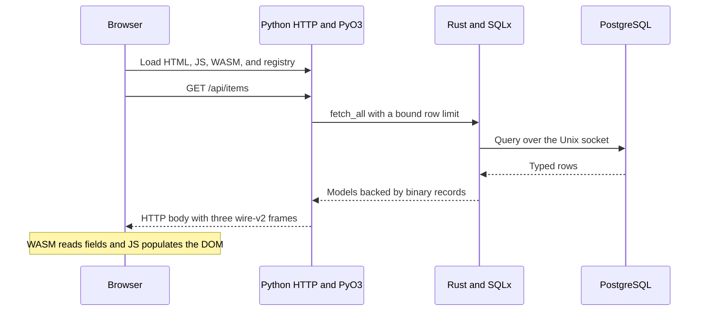

# How the browser demo runs

The demo takes three sample rows from PostgreSQL, sends a bounded binary response from Python, and renders the rows in the browser through the generated TypeScript model and WASM. Follow the [root quickstart](../../README.md) to install the tools and run it.

## From power-on to the demo

1. Platform firmware starts the operating system. A typical Linux PC uses UEFI with a bootloader or an EFI kernel. Apple Silicon starts in Boot ROM and verifies the boot components before loading macOS. [Apple Silicon boot process](https://support.apple.com/guide/security/boot-process-for-a-mac-with-apple-silicon-secb7529c706/web)
2. The kernel initializes virtual memory, scheduling, drivers, and filesystems. The system manager starts background services and the user session. Each process has its own virtual address space, and its virtual size may exceed its resident memory.
3. A terminal starts a shell. New programs receive arguments, an environment, a working directory, and inherited file descriptors. Linux loads ELF binaries and their shared libraries. On macOS, dyld loads Mach-O images. FuRy enters the Python process as a native extension and the browser as a WebAssembly module.

## From build to rendered page

The local launcher starts a disposable PostgreSQL cluster that accepts connections over a private Unix socket. It builds the CLI, native Python wheel, and WASM module with Cargo, maturin, and wasm-pack, then installs the wheel into an isolated environment. The CLI imports the [Python model](models.py) and generates the TypeScript class and schema registry. The launcher compiles TypeScript before serving the page. A deployed service can build the artifacts ahead of time.

The [Python server](server.py) opens an SQLx connection pool through the binding and serves its preloaded assets on the loopback interface. `FURY_DEMO_PORT` overrides the default port 8000. The sample query uses three literal rows, orders them by ID, and binds a row limit. It leaves database tables untouched. The server handles requests serially and uses `asyncio.run` for each data request.



| Boundary | What happens to the data |
| --- | --- |
| PostgreSQL → Rust | SQLx materializes the rows for `fetch_all`. Rust builds a `BinaryRecord` and an offset index. The schema is shared with `Arc`. |
| Rust → Python → HTTP | Building a Python model copies the Rust record buffer. `to_bytes()` makes Python `bytes`, and `b"".join(...)` assembles the HTTP body. |
| Browser → WASM | `response.arrayBuffer()` materializes the response. `Uint8Array` and `subarray` are views here. Calling the WASM constructor crosses the wasm-bindgen boundary and copies the frame into linear memory. The decoder validates known fields and indexes them. |
| WASM → DOM | The [loader](records.ts) materializes only the fields requested by its getters. It reads the 64-bit ID as `BigInt` and renders it as a string. `free()` releases the record to the WASM allocator. The linear memory size and resident process memory can stay unchanged. |

A raw Rust slice borrows from its record. The full path includes the copies shown above. Browser JS heap, WASM linear memory, process RSS, and virtual memory size measure different things. [WebAssembly memory model](https://www.w3.org/TR/wasm-core-2/)

## Inspect a live request

Run these commands in another terminal while the demo is serving. Use the printed address if the port differs.

```sh
trace_dir=$(mktemp -d)
curl -fsS --trace-ascii "$trace_dir/http.log" \
  -o "$trace_dir/page.fury" http://127.0.0.1:8000/api/items
cat "$trace_dir/http.log"
wc -c "$trace_dir/page.fury"
xxd -g1 -l96 "$trace_dir/page.fury"
```

A local capture returned HTTP 200 and 242 bytes across frames of 74, 82, and 86 bytes. The first six bytes, `4a 00 00 00 46 02`, encode a little-endian length of 74, the `F` marker, and version 2. The following `02 69 64` encodes the two-byte field name `id`, `09 00 00 00` gives the field value length, and `01` marks a present value before the eight-byte integer. See the [wire format](../../fury-core/README.md).

In browser DevTools, use **Network** to examine the WASM, registry, and data requests. Use **Performance** for runtime and rendering and **Memory** for the JS heap. Separate cold runs from warmed runs.

### Linux system calls

```sh
trace_dir=$(mktemp -d)
strace -ff -tt -T -y -e trace=%process,%file,%network,%memory \
  -o "$trace_dir/syscalls" bash scripts/test-postgres-local.sh web-serve
```

Send the request from a second terminal. `-ff` writes a file per traced process. Find the server and PostgreSQL PIDs after the build completes and look for process starts, library mappings, connections, and I/O. User-space copies and allocations frequently occur between system calls. Use a CPU or allocation profiler for those. Tracing changes timing. [strace manual](https://www.man7.org/linux/man-pages/man1/strace.1.html)

### macOS process memory

Find the demo Python PID in Activity Monitor or with `ps`, then substitute it below.

```sh
pid=12345
ps -o pid,ppid,rss,vsz,command -p "$pid"
vmmap -summary "$pid"
sample "$pid" 5 -file /tmp/fury-python-sample.txt
```

`vmmap` shows memory mappings and `sample` captures stacks. Send repeated requests during sampling if individual requests are too short to appear. The observed macOS capture above used `curl`. Use the [benchmark guide](../../benches/README.md) for timing comparisons with JSON and MessagePack.

## Test or extend the demo

CI checks the HTTP routes and reads the result with the generated TypeScript and WASM code in Node.js. Run `bash scripts/test-postgres-local.sh web` locally. Append `--browser /path/to/chromium` to also check the rendered page in a headless browser. To use an existing disposable database, export `FURY_TEST_DATABASE_URL`, run `bash scripts/check-bindings.sh --postgres`, then `bash scripts/check-web-demo.sh --serve`.

To add a field, update the [model](models.py), the [SQL projection](server.py), and the [browser loader](records.ts), then restart the demo to regenerate its model and registry.
